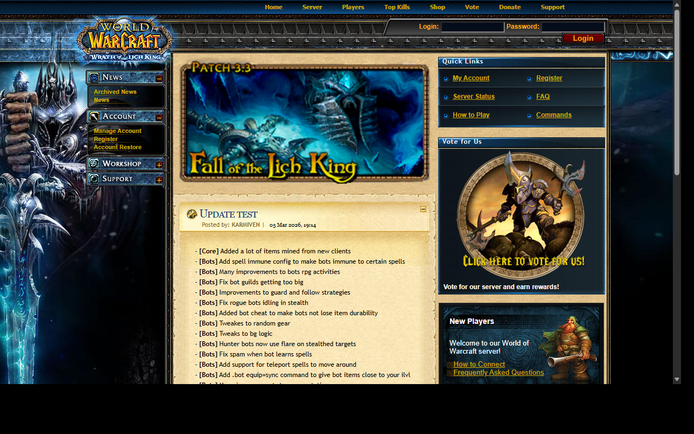
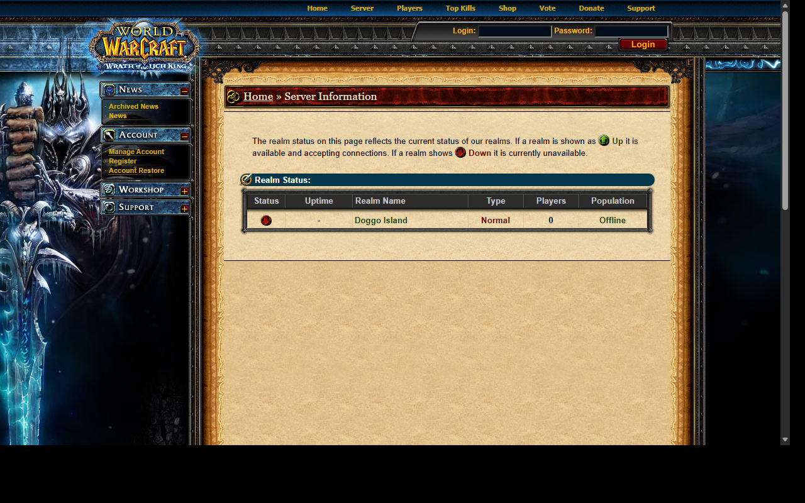

# MaNGOSWebV5

A modern Node.js/Express rewrite of MaNGOSWeb, a CMS for World of Warcraft private servers running AzerothCore (WotLK 3.3.5a).

## Screenshots

| Home | Server Status |
|------|--------------|
|  |  |

| Login | News Archive |
|-------|-------------|
|  |  |

## Status

Work in progress.

| Area | Status | Notes |
|------|--------|-------|
| Core | Done | Express, EJS, MySQL pools, MySQL-backed sessions |
| Authentication | Done | Login, registration, SRP6, password reset by emailed link |
| Account panel | Done | Characters, settings, transactions, character services |
| News, FAQ, menus | Done | Admin CRUD, limited HTML (see below) |
| Server pages | Done | Realm status, players online, character search, statistics, player map |
| Armory | Done | Character profile with equipment, guild list and roster, top lists (PvP, PvE, voters) |
| Item shop | Done | Pays with Web Points or character gold (Eluna bridge), delivers by SOAP, admin screen for unconfirmed deliveries |
| Daily reward | Done | `/vote`: press the button, get points, one claim per account per cooldown |
| Donate | Placeholder | Lists packages, no online payment yet |
| Admin panel | Done | Dashboard (registrations chart, realm cards), users, realms, shop, daily rewards, donate, regkeys, game mail, progression, reward / SOAP / purchase logs, error log, audit log |
| Installer | Done | 4-step wizard with connection checks |
| Multi-realm | Planned | Shop and services use `default_realm_id` only |

## Features

- V4 Blizzlike WotLK theme (vanilla, TBC and WotLK variants)
- Accounts compatible with the game server (SRP6), 6-16 character passwords (client limit)
- Web Points: earned from the daily reward, spent in the item shop and character services
- Gold payments: shop items can also cost character gold, charged in game by an ALE/Eluna script (see below)
- SOAP integration: server info, shop delivery, game mail
- Visitor tracking: "online" means seen in the last 5 minutes
- Security: signed double-submit CSRF cookie, rate limits, Helmet headers, brute-force lockout, admin audit log

News and FAQ text allows only `b strong i em u p ul ol li h3 h4 blockquote br` and `a` with http(s) or site-relative links. Everything else is escaped.

## Paying with gold (ALE / Eluna)

The website cannot edit the gold of an online character in the database, the worldserver would overwrite it. Instead `eluna/mangosweb_gold.lua` registers a console command that the site calls over SOAP:

1. Copy `eluna/mangosweb_gold.lua` into the worldserver `lua_scripts` folder and run `.reload eluna` (or restart).
2. Admin, Game Mail, **Test Gold Bridge** must report that the bridge answers.
3. Admin, Site Config: turn **Shop: pay with gold** on.
4. In Admin, Shop set a **Gold price** per item. Items with a gold price show a payment choice; 0 keeps them points only.

How it behaves:

- Only console/SOAP callers are served, a player typing the command in chat is ignored.
- Online characters are charged live. Offline characters are charged with a guarded SQL update.
- Gold is taken first, then the item is mailed. If delivery certainly failed, the gold is credited back; if the outcome is unknown the purchase stays in Admin, Shop, Pending purchases.
- Each charge carries a reference (`shop-<id>`), so a repeated request is not charged twice until the worldserver restarts.
- The SOAP account needs a security level allowed to run console commands.

The script has not been run against a live worldserver by the project tests. Check the first purchase on a test character.

## Stack

- Node.js 18+, Express 4, EJS + express-ejs-layouts
- MySQL 5.7+ / MariaDB, four pools: CMS, auth, characters, world (world is read-only)
- Bootstrap 5.3 for admin forms

## Project structure

```
src/
  routes/       route handlers
  models/       DB access
  middleware/   auth, csrf, theme, online tracking, lang
  services/     soap (incl. gold bridge client), srp6, mailer
  config/       database pools, migrate.js (idempotent schema upgrades run at startup)
  utils/        helpers, zones, logger
views/          pages, partials, layouts (main, admin, install)
eluna/          worldserver Lua script for gold payments
public/         themes (wotlk, tbc, vanilla), css, js, images
sql/            full_install.sql (fresh install)
test/           node:test suite
```

## Setup

1. `npm install`
2. `npm start`
3. Open `http://localhost:3000/install`. The wizard configures the databases, creates the admin account, writes `.env` and creates the CMS schema.

The installer is open to local requests only. For remote setup set `INSTALL_TOKEN` in `.env` and send it as `?token=` or the `x-install-token` header. If the CMS database is configured but unreachable at startup, the installer also requires the token.

### Environment

See `.env.example`. Notable variables:

| Variable | Purpose |
|----------|---------|
| `SESSION_SECRET` | Required once installed. Also signs CSRF and password-reset tokens |
| `BASE_URL` | Used in activation and reset emails |
| `TRUST_PROXY` | Set to the proxy hop count (e.g. `1`) behind nginx or Cloudflare, otherwise every visitor shares one IP |
| `NODE_ENV=production` | Secure session cookies, HSTS |
| `SMTP_*` | Required for registration email and password reset. Without SMTP, reset is unavailable and nothing is changed |
| `SOAP_*` | Game server remote access for game mail and server info |

### Upgrading

Schema changes for existing installs are applied automatically at startup by `src/config/migrate.js`. Back up the CMS database before the first start after an update.

## Development

- `npm run dev` watch mode
- `npm test` runs the test suite (no database needed, the DB layer is stubbed)
- Menu cache: 30 s, cleared on any menu edit. Server info cache: 2 min. SOAP `.server info` cache: per realm in Admin, Realms

## License

GPL-2.0
